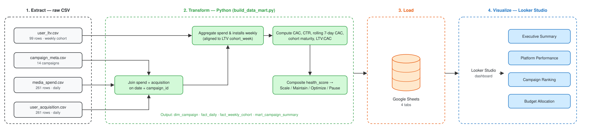
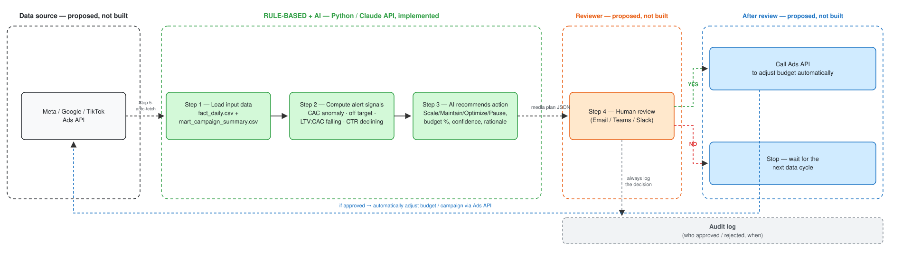

# Media Performance Analytics — Data Mart & AI Media Planner

A personal learning project in **analytics engineering** on a **synthetic** marketing dataset: 14 app-install campaigns across Facebook, Google Ads, TikTok and Instagram over 63 days. It has two parts:

1. **Data mart & dashboard** — a Python pipeline that turns four raw CSVs into grain-correct mart tables, loaded into Google Sheets and visualized in Looker Studio.
2. **AI media planner** — a prototype that computes performance signals with rule-based logic, then asks Claude (structured output) for a budget action per campaign, with a human approval step.

---

## 📊 Part 1 — Data Mart & Looker Studio Dashboard

A pandas pipeline transforms 4 raw CSV files (`data/raw/`) into 4 clean data mart tables, which are uploaded to Google Sheets as the data source for a Looker Studio dashboard.



**Key design decisions**
- **Mismatched grain.** LTV is reported per **weekly** cohort, while spend and installs are **daily**. Spend and installs are aggregated into the same weekly buckets as `cohort_week` *before* joining. A direct blend would duplicate spend or drop LTV rows.
- **No "immature" LTV.** The data only covers 63 days, so no cohort is truly 90 days old (D90 is an extrapolation). The pipeline uses the most mature window each cohort has actually reached (D90 → D30 → D7) and never recommends *Scale* without mature LTV evidence.
- **Calendar-based rolling CAC.** Gaps between readings are irregular (1–9 days), so the 7-day rolling CAC uses a **time-based** window rather than a row count, which would badly distort the average.

### Output
| File | Contents |
|---|---|
| `output/dim_campaign.csv` | Dimension — 14 campaigns, platform, budget, target CAC |
| `output/fact_daily.csv` | Fact per day × campaign — spend, installs, CAC, CTR, rolling 7-day CAC |
| `output/fact_weekly_cohort.csv` | Fact per week × campaign — joined to LTV cohorts at the correct grain |
| `output/mart_campaign_summary.csv` | One row per campaign — `health_score`, `recommended_action`; feeds the whole dashboard |

### Dashboard metrics

| Card / Chart | Formula | Meaning |
|---|---|---|
| Total Spend | `SUM(total_spend)` | Total budget spent across all campaigns |
| Blended CAC | `SUM(total_spend) / SUM(total_installs)` | Average cost per install, computed on total spend and total installs — not an average of per-campaign CACs (which would be biased) |
| Avg Mature LTV:CAC | `AVG(mature_ltv_cac)`, only campaigns with `ltv_data_status = Mature Available` | Average return-to-cost ratio, only for campaigns with real (mature) LTV |
| # Scale / # Pause | `COUNT_DISTINCT(campaign_id)`, filtered on `recommended_action = Scale` / `Pause` | Number of campaigns recommended to scale up / pause |
| Spend – Prior 7 Days | `SUM(daily_spend_vnd)`, filtered 2024-07-21 → 2024-07-27 | Spend in the comparison week |
| Spend – Last 7 Days | `SUM(daily_spend_vnd)`, filtered 2024-07-28 → 2024-08-03 | Spend in the current week |
| WoW % | `(Last 7 Days − Prior 7 Days) / Prior 7 Days × 100` | Week-over-week change in spend. Note: currently computed manually into a text box, not a calculated field that updates with the data |
| Platform CAC (line chart) | `SUM(daily_spend_vnd) / SUM(installs)`, broken down by `platform` | CAC per platform over time |
| Campaign Ranking (bar + table) | `health_score`, sorted descending | Composite campaign health: 40% CAC efficiency + 35% LTV:CAC + 25% D7 retention |
| Budget Allocation (pie chart) | `SUM(total_spend)`, dimension `platform` | How spend is distributed across channels |

Every metric above comes from `mart_campaign_summary` or `fact_daily` (both produced by `build_data_mart.py`) — none is computed directly from the raw CSVs.

---

## 🤖 Part 2 — AI-Powered Media Planning

The prototype reads Part 1's output (`fact_daily`, `fact_weekly_cohort`, `mart_campaign_summary`), computes performance signals with rule-based logic, then calls the Claude API with forced tool use (structured output) to produce a media plan recommendation per campaign.



*The green area (rule-based + AI) is implemented and runs on the data. The other areas (data source, reviewer, post-review actions) are a proposed architecture, intentionally not built in this prototype: they need real infrastructure and credentials (Slack/email, Ads APIs) and a proper approval flow before any budget is changed automatically. If a recommendation is rejected, the system stops and logs the decision — it does not retry, because the input data hasn't changed.*

**How it works**
- **Signals are computed in code, not by the model:** rolling CAC trend, z-score anomaly vs the campaign's own baseline, CAC vs target, CTR trend, LTV:CAC trend.
- **The LLM decides within guardrails:** it returns `action`, `budget_delta_pct`, `confidence`, `rationale` and optional suggestions, must cite the given numbers only, and may never recommend *Scale* when LTV is immature.
- **Mock mode:** without an API key, a deterministic rule-based stand-in applies the same governance rule, so the script runs for free and mock/live outputs are comparable.

### Run it
```bash
pip install pandas numpy anthropic

# Mock mode (default, no API key needed) — deterministic stand-in for the LLM
python scripts/ai_media_planner.py

# Live mode — calls the Claude API
export ANTHROPIC_API_KEY=your_key
python scripts/ai_media_planner.py
```
Output: `output/ai_media_plan.json`.

---

## 🗂️ Project structure

```
.
├── data/raw/                  # 4 raw CSV files (synthetic)
│   ├── campaign_meta.csv
│   ├── media_spend.csv
│   ├── user_acquisition.csv
│   └── user_ltv.csv
├── scripts/
│   ├── build_data_mart.py     # Part 1 — ETL: 4 raw CSVs → 4 mart tables
│   └── ai_media_planner.py    # Part 2 — rule-based signals + Claude API
├── output/                    # Mart tables + media plan (generated)
├── docs/                      # Architecture diagrams
└── README.md
```

## ⚙️ Run the full pipeline

```bash
pip install pandas numpy anthropic

# Part 1 — build the data mart
python scripts/build_data_mart.py
# → output/dim_campaign.csv, fact_daily.csv, fact_weekly_cohort.csv, mart_campaign_summary.csv
# (upload these 4 files to Google Sheets as the Looker Studio data source)

# Part 2 — generate the AI media plan
python scripts/ai_media_planner.py
# → output/ai_media_plan.json
```
